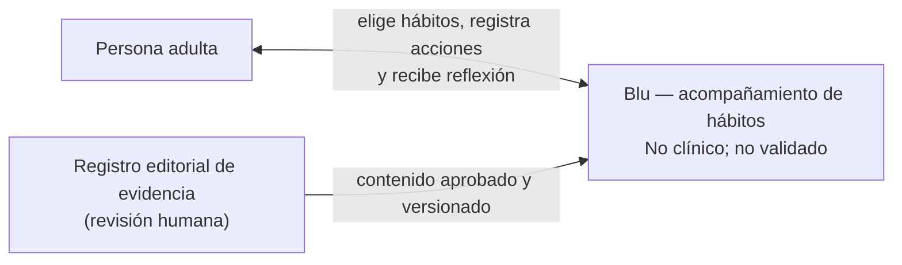
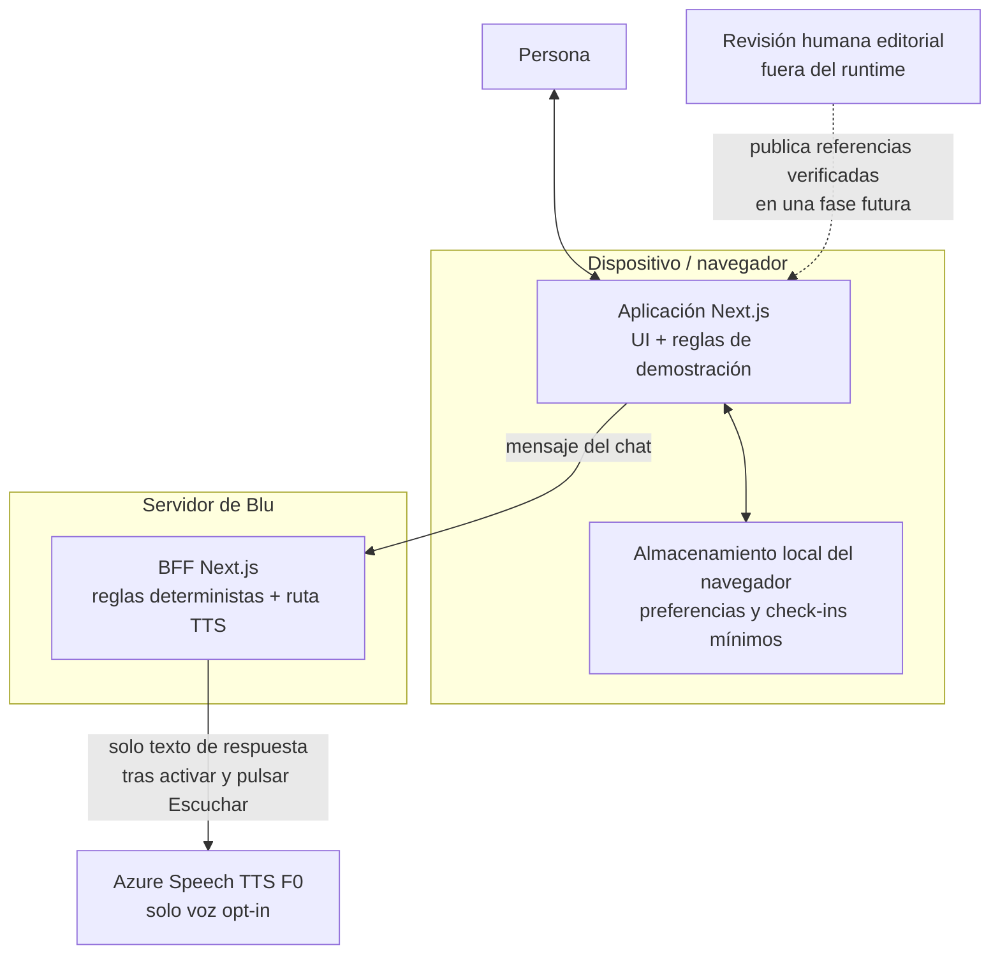

# Blu — Arquitectura C4

**Versión:** 0.1 · **Estado:** prototipo con BFF de reglas locales y TTS Azure opcional, desactivado por defecto.

## Nivel 1 — Contexto

En el prototipo no existe servicio de evidencia en línea: el catálogo de hábitos es contenido estático sin afirmación de eficacia aprobada. No se usa un proveedor generativo. Azure Speech solo se usa si la persona activa la opción y solicita leer una respuesta; su disponibilidad requiere configuración de servidor y aprobación.

## Nivel 2 — Contenedores

**Implementado:** aplicación Next.js con estado local y BFF de reglas deterministas; el chat no usa LLM ni persiste historial. La ruta Azure TTS requiere activación expresa, no registra texto/audio y permanece deshabilitada por defecto. La información del navegador no está cifrada por Blu.

**Futuro sujeto a aprobación:** cliente web → API autenticada → servicio de aplicación → base de datos cifrada; servicio de evidencia con catálogo editorial aprobado; proveedor de modelo opcional detrás de una puerta de privacidad y seguridad. No enviar conversaciones a un LLM sin aprobar ese alcance.

## Nivel 3 — Componentes lógicos

- **Interfaz:** onboarding/consentimiento, selector, check-in, revisión, adaptación, borrado.
- **Dominio local:** catálogo, validación de estado, cómputo descriptivo de siete días.
- **Guardián de seguridad:** límites no clínicos, respuesta segura ante preguntas médicas y rechazo de recomendaciones no respaldadas (en la versión con modelo).
- **Capa de evidencia (futura):** fuente, versión, población, diseño, limitaciones, fecha de revisión, aprobador y recomendación vinculada.
- **Orquestador (futuro):** flujo acotado y trazable; no ejecuta acciones autónomas ni cambia políticas.

## Decisiones arquitectónicas

1. Preferencias y check-ins son local-first; el chat se procesa en el BFF propio con reglas deterministas.
2. No añadir proveedor generativo; TTS Azure solo tras habilitación explícita y aviso previo.
3. Mantener el chat de demostración separado de cualquier afirmación de IA personalizada.
4. Toda adaptación requiere una acción del usuario; no aprender ni reentrenar automáticamente.
5. Evaluar Next.js/FastAPI/PostgreSQL solo cuando un requisito real necesite cuentas o sincronización; el texto inicial los propone, pero no los valida como decisión final.

## Flujos principales

1. Aviso y consentimiento → selección 1–3 → guardar localmente.
2. Persona marca una acción → estado asociado a fecha local → resumen descriptivo.
3. Persona solicita simplificar → elige hábito y barrera de una lista → se registra cambio y queda visible.
4. Persona borra datos → eliminar estado local y volver al onboarding.
5. Persona activa Azure TTS → aviso de envío a Microsoft → elige una respuesta y pulsa «Escuchar» → BFF devuelve audio temporal sin caché; el texto no se persiste.

## Requisitos transversales

- Fallar visiblemente ante corrupción o bloqueo del almacenamiento.
- No registrar ni persistir texto o audio del chat/TTS.
- Azure TTS: clave exclusivamente server-side; texto hasta 500 caracteres; timeout y rate limit;
  activar solo tras revisar privacidad/proveedor y confirmar recurso F0.
- No cargar fuentes remotas, píxeles de analítica ni SDKs de terceros.
- Mantener contenido estático claramente rotulado como no validado hasta revisión científica.
- Antes de nube: aislamiento por usuario, autorización en servidor, cifrado, rotación de claves, límites de retención, exportación/borrado y evaluación de proveedores.
